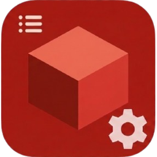

<p align="center"></p>

# Mods Core

**⬇️ Download:** [`modscore.wasm`](https://github.com/Emilchill/mods-core/raw/main/download/modscore.wasm) (Cinnabar v0.1.31 or newer). Import it in **Settings → Mods → Import mod...**

**One list of your Cinnabar mods.** Press **F10**, then click a mod to open its settings.

Mods Core is a small mod for [Cinnabar](https://github.com/cinnabar-mc/cinnabar), the Rust
Bedrock client. It shows every installed mod that supports it, with the mod's name, version
and a short description. It is drawn in the look of Bedrock's Ore UI, and the world behind it blurs and dims while it is open. Mods no longer need a
key each: Mods Core opens all of them.

- Works with Cinnabar **v0.1.31** or newer.
- Asks for one permission, **Controls**, for its own menu.
- License: MIT.

---

## Contents

1. [For players](#for-players)
2. [For mod creators](#for-mod-creators)
   - [Quick start](#quick-start)
   - [A complete example](#a-complete-example)
   - [API reference](#api-reference)
   - [How opening works](#how-opening-works)
   - [Rules and limits](#rules-and-limits)
   - [The protocol](#the-protocol-version-1)
3. [Building Mods Core](#building-mods-core)
4. [Troubleshooting](#troubleshooting)

---

## For players

### Install

1. Download `modscore.wasm`.
2. In Cinnabar, go to **Settings → Mods → Import mod...** and pick the file.
3. Enable **Mods Core** and allow **Controls** when Cinnabar asks.

### Use

| Action | What happens |
| --- | --- |
| **F10** | Opens the list in the middle of the screen. |
| Mouse wheel, or **^** / **v** | Scrolls the list (5 mods per page). |
| Click a mod | Its menu opens and the list closes. |
| **Escape** or **F10** in a mod's menu | Closes it. Press **F10** again for the list. |

Each row shows the mod's **name**, its **version** in a tag, and a two-line **description**.
A mod you turn off leaves the list after a few seconds.

### Mods with their own key

Mods that support Mods Core have **no key by default**. Many let you set one in their own menu
if you want it. That key and Mods Core work together.

### Load order

Cinnabar shows one mod menu at a time. A mod with a menu that **does not** support Mods Core
and sits **above** Mods Core in **Active mods** can still take the screen. Keep Mods Core and
the mods that support it above those mods.

---

## For mod creators

Your mod joins the list with **one file and a few lines of code**.

The messages travel on Cinnabar's `events` cue channel, which needs no grant. Opening your
menu uses your own panel, which needs the **controls** grant, as any menu does.

### Quick start

1. **Copy the file.** Copy [`mods/modscore/src/mods_core.rs`](mods/modscore/src/mods_core.rs)
   into your mod's `src/` folder and add it to `lib.rs`:

   ```rust
   mod mods_core;
   ```

2. **Create a `Link` once.** Give it your slug, name, version and description:

   ```rust
   thread_local! {
       static CORE: std::cell::RefCell<crate::mods_core::Link> =
           std::cell::RefCell::new(crate::mods_core::Link::new(
               "my-mod",                  // slug: 1-21 characters, a-z, 0-9 and -
               "My Mod",                  // name in the list
               env!("CARGO_PKG_VERSION"), // version in the list
               "What my mod does, in one or two short lines.",
           ));
   }
   ```

3. **Call it in every frame callback**, after reading controls. Pass whether a menu is open
   and a function that builds your whole panel JSON:

   ```rust
   let event = CORE.with_borrow_mut(|link| link.frame(controls.panel_open, || my_panel_json()));
   ```

4. **Give your panel no key.** Cinnabar needs a `toggle_key` in every panel. Use `"F24"`, a key
   nobody presses. Do not use **F10**, because Mods Core uses it.

That's all. Mods Core lists your mod, and a click opens your menu.

### A complete example

A minimal mod with one switch, listed in Mods Core. The mod has no key of its own unless the
player sets one.
It shows the shape of the code; put your own JSON-UI document where it says so.

```rust
use std::cell::RefCell;
use mod_api::bindings::{Guest, cinnabar::extension::{input, panel}};

mod mods_core;

struct Mod;

#[derive(Default)]
struct State {
    enabled: bool,
    /// The player's own menu key, if they set one ("" for none).
    menu_key: String,
}

thread_local! {
    static STATE: RefCell<State> = RefCell::new(State::default());
    static CORE: RefCell<mods_core::Link> = RefCell::new(mods_core::Link::new(
        "my-mod", "My Mod", env!("CARGO_PKG_VERSION"), "Does one useful thing.",
    ));
}

/// The whole panel: called only when the menu opens.
fn panel_json(state: &State) -> String {
    format!(
        r#"{{"toggle_key":"F24","controls":[{{"kind":"toggle","id":"enabled","label":"Enabled","value":{}}}],
            "surface":{{"screen":"mymod.menu","document":"...your JSON-UI document, escaped...","bindings":{{}}}}}}"#,
        state.enabled
    )
}

impl Guest for Mod {
    fn init() {}

    fn frame() {
        STATE.with_borrow_mut(|state| {
            let mut keys = Vec::new();
            if !state.menu_key.is_empty() {
                keys.push(state.menu_key.clone());
            }
            let Ok(controls) = input::read_selected_controls(&input::Selection {
                keys_pressed: Some(keys),
                keys_held: Some(Vec::new()),
                keys_admitted: Some(Vec::new()),
                events: true,
            }) else {
                return;
            };

            // The player's own key, if any: open or close through Mods Core.
            if !state.menu_key.is_empty() && controls.keys_pressed.iter().any(|k| *k == state.menu_key) {
                CORE.with_borrow_mut(|link| link.toggle(controls.panel_open));
            }

            // Mods Core: announce this mod, and set or drop the panel.
            let event = CORE.with_borrow_mut(|link| link.frame(controls.panel_open, || panel_json(state)));
            if event == mods_core::Event::Opened {
                // The panel was just set; its values are already in it.
            }

            // Your menu's events, as usual.
            for event in &controls.events {
                if event.id == "enabled" {
                    state.enabled = event.value >= 0.5;
                }
            }
        });
    }
}

mod_api::bindings::export!(Mod with_types_in mod_api::bindings);
```

> **Tip:** `controls.panel_open` tells you whether **any** mod's menu is open, not only yours.
> Use `link.has_panel()` to know whether the open menu is yours, for example before you send
> your values with `panel::update_content`.

### API reference

Everything is in `mods_core.rs`.

#### `Link::new(slug, name, version, description) -> Link`

Creates your mod's link. Make it once and keep it, for example in a `thread_local!`.

| Argument | Rules |
| --- | --- |
| `slug` | Your mod's id: 1-21 bytes of `a-z`, `0-9` and `-`. Keep it the same between versions. |
| `name` | Shown as the row title. |
| `version` | Shown in the version tag, with a `v` in front. |
| `description` | Shown in two lines of about 58 characters each. |

Name, version and description together are cut to 252 bytes of UTF-8.

#### `link.frame(panel_open, whole_panel) -> Event`

Call it **once per frame callback**.

- `panel_open`: `controls.panel_open` from your controls.
- `whole_panel`: a closure that returns your complete panel JSON, the same thing you would
  give `panel::set_content`. It runs only when your menu opens.

On each call, `frame`:

- sends one piece of your info to Mods Core;
- when Mods Core asks for your menu, sets your panel and opens it;
- when your menu closes, or another mod's menu opens, removes your panel;
- on its first call, removes the panel your component brought at load.

It returns one of these events:

| `Event` | Meaning |
| --- | --- |
| `Nothing` | Nothing changed this frame. |
| `Opened` | Your panel was just set and opened. Send your values now if your panel needs them. |
| `Closed` | Your menu was closed and your panel was removed. Good moment to end temporary modes (for example "move with the mouse"). |

#### `link.toggle(panel_open)`

For the player's **own** menu key. It opens your menu (through the same hand-over Mods Core
uses) or closes it if it is open. It works without Mods Core installed too.

#### `link.has_panel() -> bool`

`true` while your panel is set, which means your menu is open or opening. Check it before you
send values with `panel::update_content`, because `controls.panel_open` is about whichever
menu is shown.

#### Helpers

These are only needed if you write your own Mods Core client or list:

| Function | Purpose |
| --- | --- |
| `valid_slug(slug)` | Whether a slug can be used. |
| `text(name, version, description)` | The info text, cleaned and cut to 252 bytes. |
| `chunks(text)` | The info cues' values. |
| `read_chunk(name, values)` | Reads one info cue (Mods Core's side). |
| `parse(bytes, checksum)` | Name, version and description from a whole text. |
| `checksum(bytes)` | The 16-bit text checksum. |
| `open_cue(slug)` | The `mcore.open.<slug>` cue name. |

### How opening works

Cinnabar shows **one mod menu at a time**:

- It shows the menu of the mod the player last chose **with that mod's key**. That is Mods
  Core, chosen with F10.
- If that mod has no panel, it shows the **first mod in load order that has a panel**.
- A mod cannot bring its own menu to the front.

So mods that use Mods Core keep **no panel while their menu is closed**:

1. The player clicks your mod. Mods Core sends `mcore.open.<slug>` and removes its own panel.
2. Your `Link` sets your whole panel and opens it. Yours is now the only menu, so Cinnabar
   shows it.
3. While your menu is open, `Link` sends `mcore.busy.<slug>` every frame.
4. When the player closes your menu, `Link` removes your panel. Once no mod has been busy for
   a moment, Mods Core puts its own panel back, ready for the next F10.

If your menu takes a few frames to show, `Link` asks Cinnabar again. If the menu never
shows, `Link` gives up after about a second.

### Rules and limits

- Call `link.frame(...)` in **every** frame callback. Mods Core forgets mods it has not heard
  from for about 4 seconds.
- Do not call `panel::set_content` yourself while your menu is closed. That would give you a
  panel, and Cinnabar could show your menu instead of the one the player chose.
  `panel::update_content` is fine: it does nothing while you have no panel.
- Do not use **F10** as a key. Mods Core uses it.
- Use a `toggle_key` nobody presses, such as `"F24"`.
- Building your whole panel should be cheap. It runs inside a frame callback, and a frame
  has 200,000 fuel. Keep your JSON-UI document pre-escaped and avoid escaping it character by
  character at run time.

### The protocol (version 1)

You only need this if you write the messages yourself instead of using `mods_core.rs`.

| Cue | Sent by | Values | Meaning |
| --- | --- | --- | --- |
| `mcore.t.<slug>` | each mod, all the time | 8 numbers | one chunk of the mod's info |
| `mcore.open.<slug>` | Mods Core on a click, or a mod for its own key | none | open that mod's menu |
| `mcore.busy.<slug>` | a mod, every frame its menu is open | none | Mods Core waits before taking its panel back |

**When you receive `mcore.open.<slug>`:**

- If it names your mod, set your whole panel and open it.
- If it names another mod, remove your panel if you have one.
- Mods Core removes its own panel on any open request. It takes the panel back about 12 frames
  after the last busy cue.

**Info text:** UTF-8 `name` + `U+001F` + `version` + `U+001F` + `description`, at most 252
bytes.

**Chunks:** the text is cut into chunks of 18 bytes, and the last chunk is padded with zero
bytes. Each chunk is sent as `[index + 256 * count, checksum, d0, d1, d2, d3, d4, d5]`.

- Every `d` holds three bytes: `b0 * 65536 + b1 * 256 + b2`. This value is exact in an `f32`.
- `checksum` covers the whole text: start at 7, then for each byte
  `sum = (sum * 31 + byte) & 0xFFFF`. It lets Mods Core notice when the text changes.

**Timing:** send the chunks one after another and start over at the end. One cue every other
frame is enough.

**Cinnabar limits:**

- Cue names are at most 32 bytes and may use `a-z`, `0-9`, `.`, `_` and `-`.
- A cue carries up to 8 numbers.
- A mod can send up to 16 cues per frame.
- A mod reads up to 64 cues per callback.

---

## Building Mods Core

You need Rust 1.99 or newer with the `wasm32-unknown-unknown` target, and Python 3.

```sh
python3 tools/gen_surface.py   # the screen: src/surface.json, surface.escaped, surface_controls.rs
python3 scripts/build-mod.py   # dist/modscore.wasm
cargo test                     # protocol, list and panel tests
python3 tools/preview.py out.png   # a rough PNG preview of the screen
```

### Project layout

| Path | What it is |
| --- | --- |
| `mods/modscore/src/mods_core.rs` | The protocol and `Link`, the file creators copy. |
| `mods/modscore/src/list.rs` | Assembles the info chunks into the list of mods. |
| `mods/modscore/src/view.rs` | The panel JSON and its value patches. |
| `mods/modscore/src/guest.rs` | The frame loop: cues, scrolling, clicks, the hand-over. |
| `tools/gen_surface.py` | Generates the Ore UI style screen. |
| `mods/modscore/pack/` | Packs the component: name, description, icon, grants, panel bundle. |
| `assets/icon.png` | The mod icon (256 × 256). |

### Title font (personal builds only)

By default every text uses the game's own font. To draw the title in another font, build with
the font embedded:

```sh
TITLE_FONT=mod_panel python3 tools/gen_surface.py
MODSCORE_FONT=/path/to/font.ttf python3 scripts/build-mod.py
```

Cinnabar reads TTF and OTF files of up to 2 MB.

> **Do not publish a build that embeds a font you may not share.** Minecraft's own fonts
> (Minecraft Seven, Ten, Sixteen) belong to Mojang, all rights reserved. The published
> `modscore.wasm` embeds no font.

---

## Troubleshooting

| Problem | Fix |
| --- | --- |
| "is not a valid mod ... wrong type" when importing | Your Cinnabar is older than v0.1.31. Update it. |
| F10 does nothing | Make sure Mods Core is enabled and has the **Controls** permission. |
| A mod is not in the list | It does not support Mods Core yet. If it does, it may be off or failing: check it in Settings → Mods. |
| Another mod's menu appears instead | A mod that does not support Mods Core is above it in Active mods. Move Mods Core up. |
| A mod's menu opens and closes at once | Update that mod to the latest `mods_core.rs`. Older copies did not wait for the menu to show. |


## Phones and tablets (Android)

There is no F10 on a phone: with touch controls, Mods Core shows a **Mods** button that opens the list. Move it with the touch layout editor. Cinnabar on iOS does not run mods.
